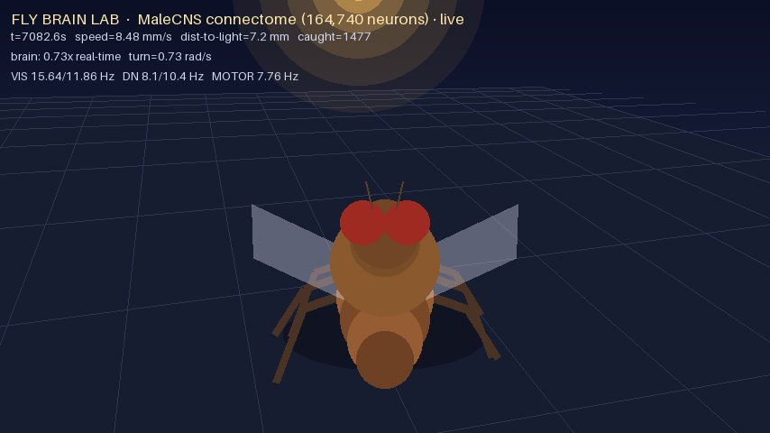
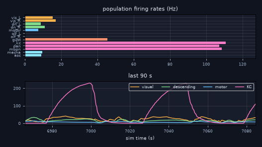

<div align="center">

# 🪰 FLY BRAIN LAB

**A live, embodied simulation of the male fruit fly central nervous system**
**— running the real 164,740-neuron connectome as a spiking network, streamed to your browser.**





</div>

---

## What this is

This project runs the **actual wiring diagram** of the adult male *Drosophila melanogaster*
central nervous system (brain + ventral nerve cord, **MaleCNS v1.0**, 166,700 neurons /
25.6M traced synaptic connections, produced by HHMI Janelia + University of Cambridge +
MRC LMB + **Google Research**) as a live **leaky integrate-and-fire (LIF) spiking network**,
and closes the loop with a simple body in a light world:

```
light / visual scene
        │  (per-eye intensity, photoreceptor drive)
        ▼
   sensory neurons ──►  REAL CONNECTOME  ──► descending neurons ──► motor neurons
   (ol_sensory)         164,740 neurons         (descending_neuron)     (vnc_motor)
        25,568,639 signed synaptic edges
        │
        ▼
   body: yaw, speed, wingbeat  ──►  3D render  ──►  live MJPEG stream
```

Everything between the eyes and the muscles is the measured connectome — no hand-wired
behaviour network. Neurotransmitter identity (from Janelia's predictions) sets each
synapse's sign: **GABA / glutamate → inhibitory**, acetylcholine etc. → excitatory.
Weights are the traced synapse counts, normalized per postsynaptic neuron.

### Verified numbers (this build)

| quantity | value |
|---|---|
| neurons in graph | **164,740** |
| synaptic edges (merged) | **25,568,639** |
| inhibitory neurons | 51,352 |
| visual sensory / descending / motor | 4,109 / 1,314 / 815 |
| Kenyon cells / DAN / MBON | 4,064 / 340 / 97 |
| video loop | ~25 fps @ 854×480 |
| brain clock | 0.3–0.6× real-time (4 vCPU, no GPU) |

## Quick start

```bash
git clone https://github.com/opendeta/fly-semulator && cd fly-semulator
pip install -r requirements.txt
bash scripts/fetch_data.sh          # ~535 MB, no login needed
cd scripts && python3 webapp.py     # prints a login, serves http://127.0.0.1:8000
```

Then open `http://127.0.0.1:8000` and log in with the credentials printed on start.

To expose it to the internet with a temporary public HTTPS URL:

```bash
cloudflared tunnel --url http://127.0.0.1:8000 --no-autoupdate --protocol http2
```

> UDP/QUIC is blocked on many sandboxes — use `--protocol http2` if the tunnel
> reports `QUIC connection failed`.

### Bengali quickstart (বাংলা)

```bash
bash scripts/fetch_data.sh   # কানেক্টোম ডেটা নামাবে (~৫৩৫ MB)
cd scripts && python3 webapp.py
```

ব্রাউজারে `http://127.0.0.1:8000` খুলে স্ক্রিনে প্রিন্ট হওয়া ইউজার/পাসওয়ার্ড দিয়ে ঢুকুন।
পাবলিক লিংক চাইলে উপরের `cloudflared` কমান্ডটি চালান।

## What you can do in the dashboard

* **live 3D fly** (MJPEG, ~25 fps) walking/flying toward a drifting light
* **live brain panel** — population firing rates per neuron group + 90 s history
* **remote control** — move the light (◀▶▲▼), on/off, auto-drift, pause, reset
* **sliders** — innate phototaxis strength, brain steering gain, speed

## Files

| file | role |
|---|---|
| `scripts/fetch_data.sh` | download MaleCNS data (CC-BY) and build the compact graph |
| `scripts/build_brain.py` | feather → signed CSR matrix + neuron metadata |
| `scripts/brain_sim.py` | numba event-driven LIF engine over the connectome |
| `scripts/world_sim.py` | body dynamics, light world, phototaxis, brain thread |
| `scripts/fly_render.py` | 3D fly/light renderer (CPU, PIL) |
| `scripts/brain_panel.py` | live activity panel (matplotlib Agg) |
| `scripts/webapp.py` | Flask dashboard: MJPEG + panel + control API |
| `scripts/bench_loop.py` | loop benchmark (fps, brain real-time factor) |

## Honest limitations

* LIF is a **strong simplification**: real neurons have unknown dynamics, delays,
  neuromodulation and electrical synapses that the connectome does not contain.
  Firing rates are tuned to biologically plausible ranges; they are not measurements.
* The body is a **stylized 3D model**, not NeuroMechFly/MuJoCo; the loop is
  sensory → connectome → descending/motor → steering, with an explicit innate
  phototaxis term alongside the brain-derived term (both are exposed as sliders).
* Rendering and the brain run on CPU. No GPU is required; a GPU would raise the
  brain clock and let us run MuJoCo + MJWarp instead of the stylized body.

## Roadmap

- [x] MaleCNS connectome → live LIF brain + body loop + public dashboard
- [ ] video-driven visual input (upload a clip → fly sees it)
- [ ] dopamine-gated plasticity on Kenyon-cell → MBON synapses (learning)
- [ ] odor/visual conditioning trainer console
- [ ] optional MuJoCo (NeuroMechFly) body when a GPU machine is available

## Citing the data

If you use this project, cite the connectome it runs on:

* **Berg, S. et al.** *Sexual dimorphism in the complete connectome of the Drosophila
  male central nervous system.* Cell (2025). Dataset: **MaleCNS v1.0**,
  https://male-cns.janelia.org/ (CC-BY 4.0)
* **Dorkenwald, S. et al.** *Neuronal wiring diagram of an adult brain.* Nature (2024).
* **Schlegel, P. et al.** *Whole-brain annotation and multi-connectome cell typing.*
  Nature (2024).
* **Shiu, P. K. et al.** *A Drosophila computational brain model reveals sensorimotor
  processing.* Nature (2024) — whole-brain LIF modelling.
* **Eckstein, N. et al.** neurotransmitter prediction (2024).

Data licence: **CC-BY 4.0** (Janelia / FlyWire Consortium). This repository's code is
**MIT**; the data is *not* redistributed here — it is downloaded at runtime.

## Ethics / scope

This is a scientific simulation of an insect nervous system. It is not alive and has no
consciousness, and the project deliberately covers only non-sexual behaviours
(locomotion, vision, learning, grooming).
